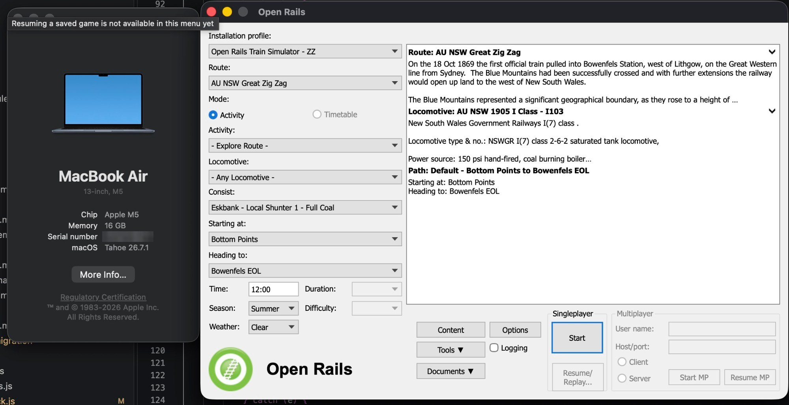
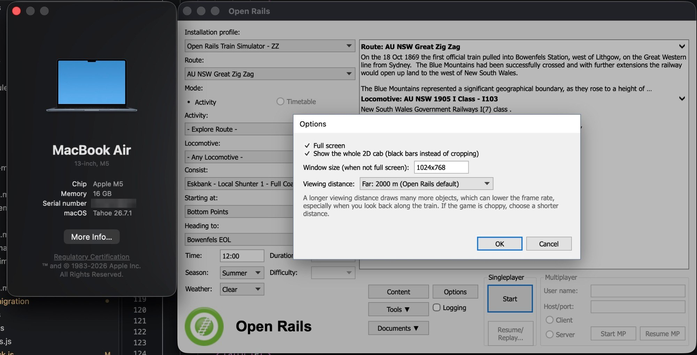
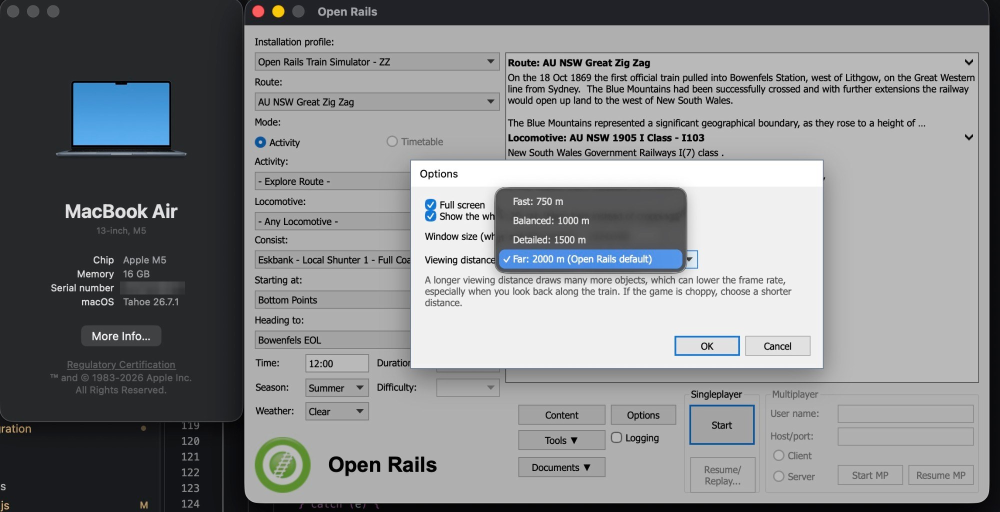
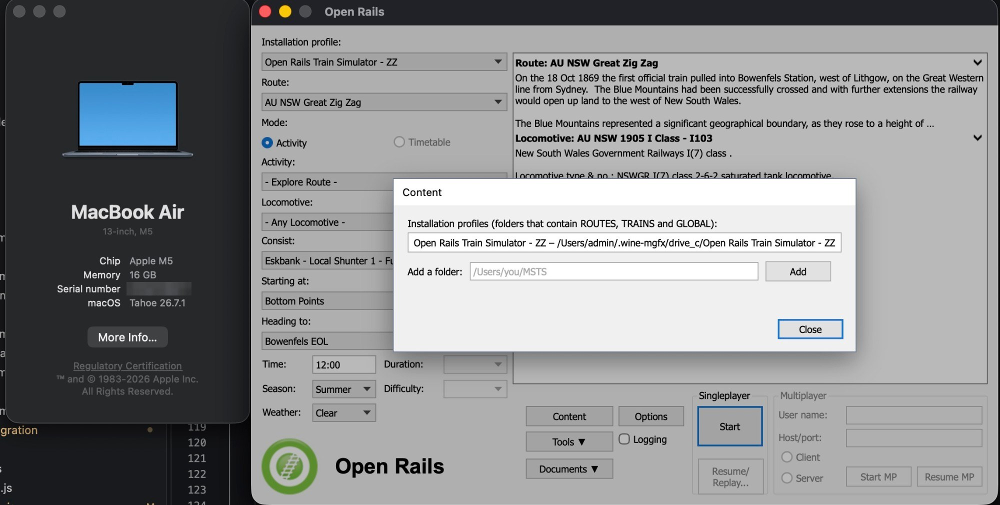
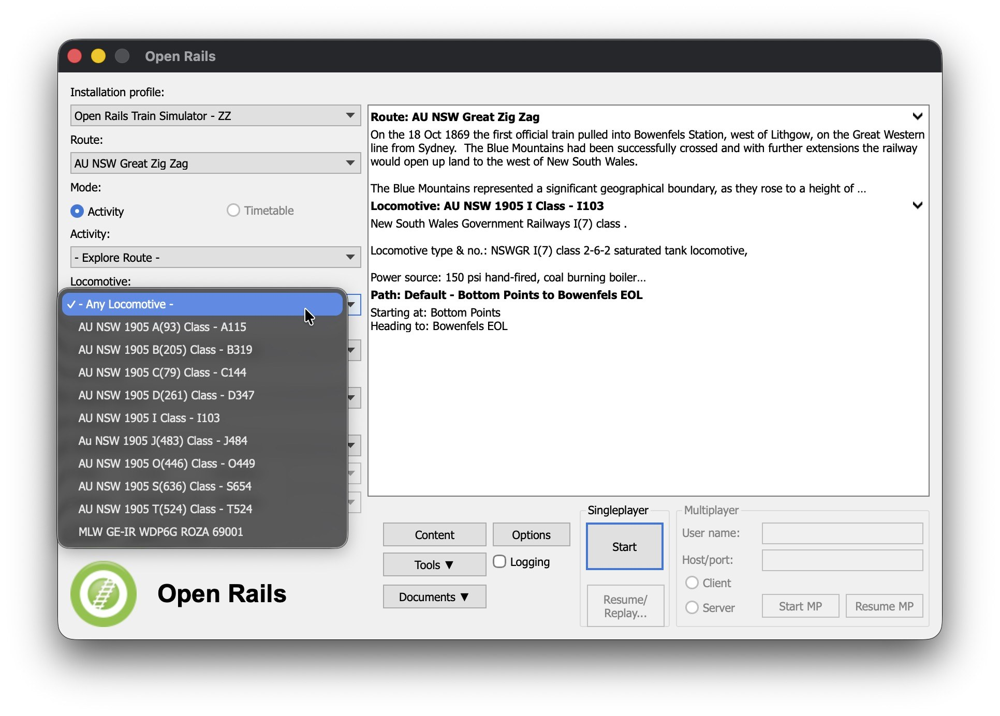
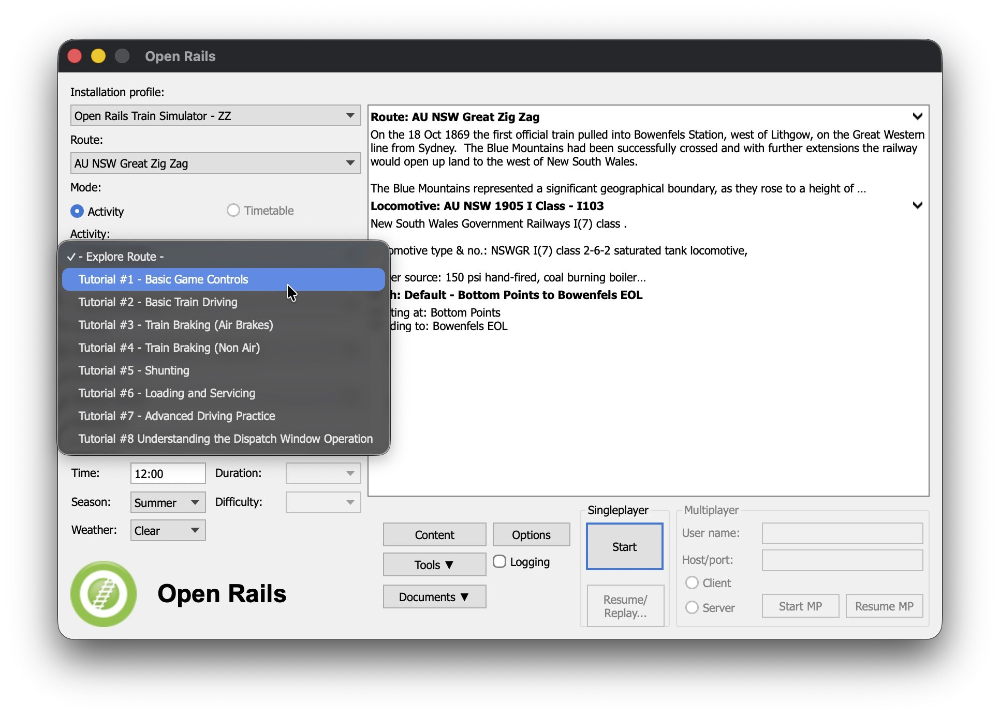
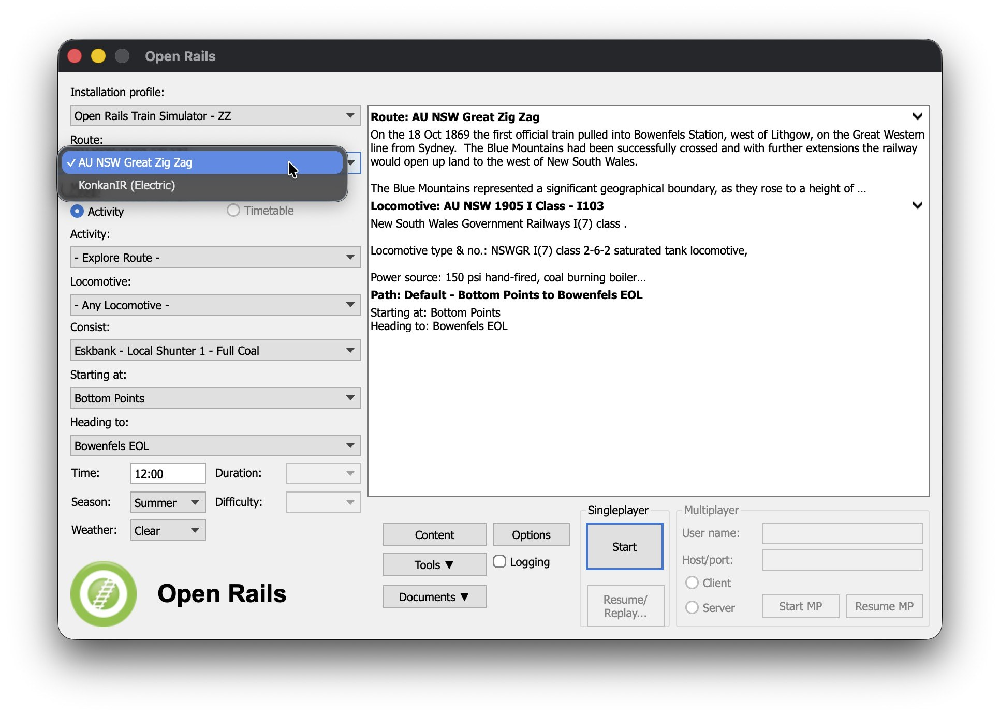
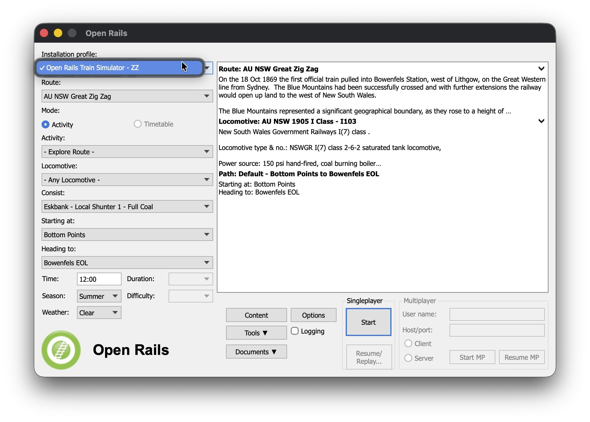

# Open Rails — Native Apple Silicon (macOS) Port

This is a **native macOS build of the [Open Rails](http://www.openrails.org/) train
simulator engine**, running directly on Apple Silicon (M-series) Macs — no Windows,
no Wine, no virtual machine.

As far as we can tell, this is the **first native Mac build of the Open Rails engine.**
It has been confirmed running successfully after a full set of cross-platform fixes.

> This repository is the complete Open Rails source (a fork of
> [`openrails/openrails`](https://github.com/openrails/openrails)) with the macOS port
> committed on top. To see exactly what changed, diff this branch against upstream
> `openrails/openrails` `master`.

---

## ✅ Status

- Runs natively on **Apple Silicon (arm64)** macOS.
- Uses the **.NET runtime** with **SDL2** and **OpenAL** (via Homebrew) for windowing,
  input and audio.
- Loads standard MSTS / Open Rails route and rolling-stock content, same as the
  Windows version.
- Tested on a **MacBook Air (13-inch, Apple M5, 16 GB)** with **macOS Tahoe 26.7.1**.

---

## 📸 Screenshots

The Open Rails menu as a native Mac app, running on a MacBook Air (M5). It follows the layout
and behaviour of the Open Rails menu on Windows. (Screenshots taken on the author's Mac; the
serial number is blurred.)



**Options:** full screen, show the whole 2D cab, window size and viewing distance.



**Viewing distance:** a shorter distance usually gives a smoother frame rate.



**Content:** your installation profiles, and adding another content folder.



**Choosing what to play** (native Mac pop-up lists):

 

 

---

## 🚀 Quick Start (no compiling needed)

The GitHub source tree does **not** contain the compiled game or its compiled shader
files (`Program/Content/*.mgfx`). If you just want to play, download the ready-to-run
build instead of the repository ZIP:

1. Download **`OpenRails-macOS-arm64.zip`** from the
   [latest Release](https://github.com/Aman1945/OPEN-RAIL-MAC/releases/latest).
2. Install the prerequisites once (needs [Homebrew](https://brew.sh)):
   ```bash
   brew install dotnet sdl2 openal-soft
   ```
3. Unzip, then in Terminal (once):
   ```bash
   cd ~/Downloads/OpenRails-macOS-arm64
   xattr -dr com.apple.quarantine .   # lets macOS run the downloaded libraries
   ```
4. Double-click **`Open Rails`** (the app). The menu opens in its own window and looks and
   works like the Open Rails menu on Windows: pick a route, an Activity or an Explore run
   (locomotive, consist, path, time, season, weather), and press **Start**.
   (`Open Rails Menu.command` opens the same menu in your web browser instead.)

New here? Read the **[User Manual](macOS/USER-MANUAL.md)**: install, starting the game, the
keys, troubleshooting.

You still need MSTS / Open Rails route and rolling-stock content to drive a train. The menu
finds it automatically in `~/MSTS` (the folder that contains `ROUTES`, `TRAINS` and `GLOBAL`);
if yours is elsewhere, press **Content** in the menu and add the folder once.

**Options** has a few display settings (full screen, window size, viewing distance, and "show the
whole 2D cab" if the cab looks cropped on a widescreen display). If something is missing, the
menu shows a red "Setup problem" with how to fix it. Prefer the command line? `./run-openrails.sh -start -explorer
<path.pat> <consist.con> 12:00:00 1 0` does the same thing.

**Black screen, or "Loading.mgfx is missing"?** You are running a build made from the
source ZIP. Use the Release download above — it includes all 12 compiled shaders.

---

## 🛠 Requirements

- A **Mac with Apple Silicon** (M1/M2/M3/M4…).
- **.NET runtime** installed (the build targets `net8.0` and runs on newer runtimes
  via `--roll-forward LatestMajor`).
- **Homebrew** with the native libraries:
  ```bash
  brew install sdl2 openal-soft dotnet
  ```
- MSTS / Open Rails **route + rolling-stock content** to actually drive a train
  (same content the Windows Open Rails uses).

---

## ▶️ Running (advanced / building from source)

Most people should use the [Quick Start](#-quick-start-no-compiling-needed) above. This
section is for running from a build you compiled yourself. Note that compiling also
requires building the `.fx` shaders to `.mgfx` (OpenGL profile) with MonoGame's `mgfxc`.

From the built program folder (`Program/`):

```bash
# Tell the loader where the Homebrew native libs are
export DYLD_LIBRARY_PATH="/opt/homebrew/lib:$DYLD_LIBRARY_PATH"

# --roll-forward LatestMajor lets the net8.0 build run on a newer installed .NET runtime
dotnet exec --roll-forward LatestMajor RunActivity.dll [arguments...]
```

Example (explorer mode):

```bash
dotnet exec --roll-forward LatestMajor RunActivity.dll \
  -start "-explorer" "PATH_TO_ROUTE" "CONSIST" "PATH" "TIME" "SEASON" "WEATHER"
```

The command-line arguments are the same as Windows Open Rails.

---

## 🔧 What was changed for macOS

The port adds a small set of platform-compatibility shims and cross-platform fixes
across `Orts.Common`, `Orts.Content`, `Orts.Formats.*` and `RunActivity`. Key new
files:

| File | Purpose |
|------|---------|
| `Orts.Common/FileSystemCompat.cs` | Case-insensitive / cross-platform path handling |
| `Orts.Common/SimpleIniReader.cs` | Portable INI reading (no Windows API) |
| `Orts.Formats.Msts/DxtDecompress.cs` | Software DXT texture decompression |
| `RunActivity/Viewer3D/Popups/DpiCompat.cs` | DPI handling without Windows Forms |
| `RunActivity/Viewer3D/Popups/SkiaFont.cs` | Font rendering via SkiaSharp |
| `RunActivity/Viewer3D/UIThreadMarshal.cs` | Main-thread marshalling |
| `RunActivity/Viewer3D/UserInputRailDriverStub.cs` | RailDriver stub for non-Windows |

Plus numerous smaller edits to replace Windows-only APIs, fix path separators,
texture loading, and threading behaviour so the engine builds and runs on macOS.

---

## 🙏 Credits

- **Open Rails** and its engine — the [Open Rails team](http://www.openrails.org/)
  and all upstream contributors.
- **macOS / Apple Silicon port** — Aman Prajapati (India).

## 📄 License

Open Rails is released under the **GNU General Public License (GPL)**. This port
inherits the same license — see [`LICENSE`](LICENSE).
